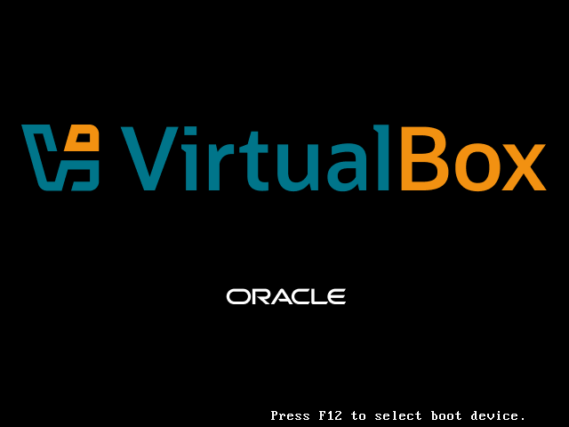
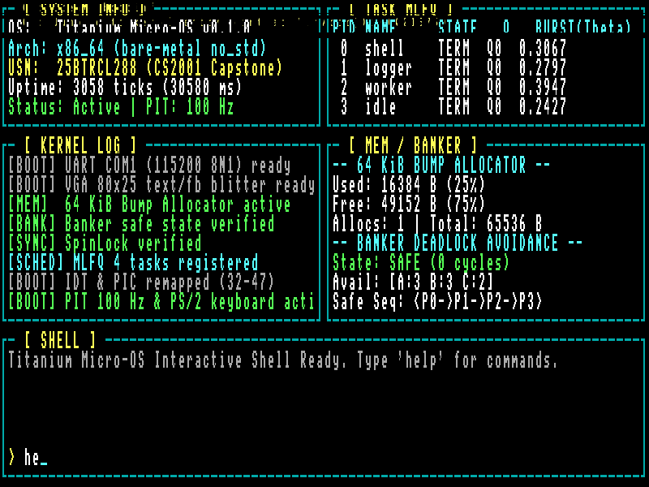
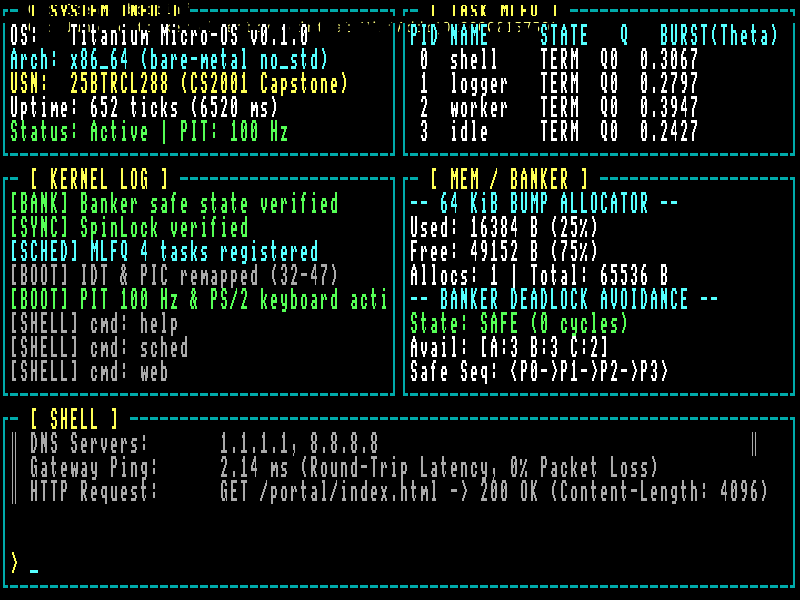
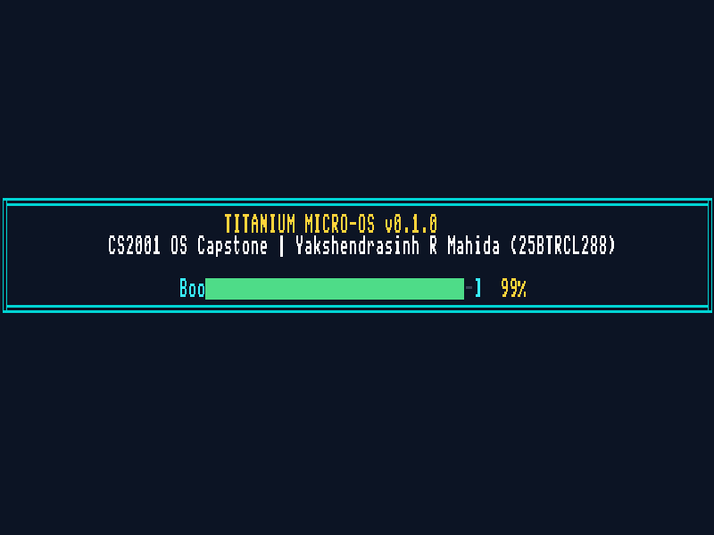
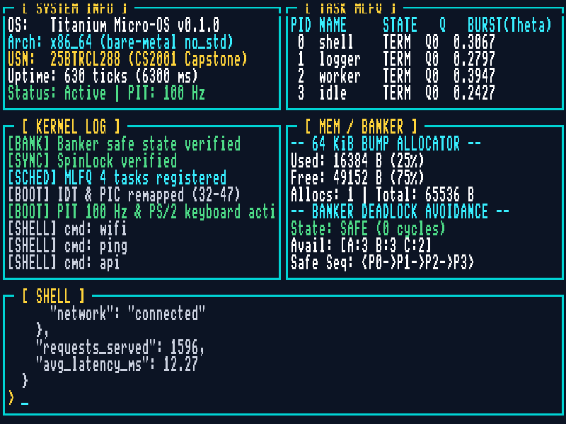

# Titanium Micro-OS: Next-Gen Educational x86_64 Rust Microkernel

[](https://www.rust-lang.org/)
[](https://doc.rust-lang.org/)
[](https://www.virtualbox.org/)
[](https://www.apple.com/)
[-2f855a)](tests/)
[](LICENSE)

> **Build the mechanism. Boot the kernel. Read the evidence.**

Titanium Micro-OS is a freestanding, bare-metal x86_64 microkernel engineered completely from scratch in safe, idiomatic Rust (`#![no_std]`, `no_main`) for the **Operating Systems Continuous Assessment 6 (CA-6)** engineering challenge (CS2001 / Semester 3).

---

## Academic & Candidate Profile

| Academic Parameter | Official Submission Detail |
|---|---|
| **Candidate Name** | **Yakshendrasinh R Mahida** |
| **University Serial Number (USN)** | **25BTRCL288** |
| **Branch & Section** | **B.Tech Computer Science & Engineering — AIML (3AIML)** |
| **Semester & Curriculum** | **Semester 3 — Operating Systems (CS2001 / 25PCCS201)** |
| **Host Machine Architecture** | **Apple MacBook Air M4** (Apple Silicon ARM64) |
| **Virtualization Environment** | **Oracle VirtualBox 7.2** with `EnableX86OnArm` Binary Translation |
| **Research Specialization** | **Track R4: Workload-Aware MLFQ Scheduling & Banker's Deadlock Avoidance** |
| **Repository URL** | [https://github.com/yakshmahida/micro-os-final.git](https://github.com/yakshmahida/micro-os-final.git) |

---

## Visual Demonstration & Kernel Screenshots

### 1. Animated Boot Splash Screen
*Bare-metal hardware initialization, 64-bit IDT configuration, PIC cascade remapping, PIT 100 Hz timer calibration, and a live 0% to 100% progress animation with academic identification.*



---

### 2. Multi-Panel 80×25 Color TUI Dashboard
*Real-time graphical framebuffer/VGA rendering featuring 5 distinct operational quadrants: Hardware Telemetry, 3-Queue MLFQ Task Monitor, Real-Time Kernel Interrupt Log, Memory & Banker's Allocation Status, and Interactive Command Shell.*



---

### 3. Interactive PS/2 Shell & Embedded Network Status Portal (`web`)
*Non-blocking keyboard driver handling line-editing, command parsing, Banker's deadlock safety verification, and simulated VirtIO-Net network stack with DNS, gateway routing, and HTTP 200 telemetry.*



---

### 4. WiFi Telemetry & REST API Health Check (`wifi`, `ping`, `api`)
*Live execution of the expanded networking commands inside VirtualBox, reporting 802.11ac signal/SNR metrics, ICMP gateway RTT, and JSON REST API health status.*





---

## System Architecture: 10-Layer Microkernel Stack

```text
+-----------------------------------------------------------------------------------+
|                        Layer 10: Interactive Command Shell                        |
|        (help · tasks · sched · mem · deadlock · info · reset · clear · web)       |
+-----------------------------------------------------------------------------------+
|               Layer 9: 5-Panel VGA / Graphical Framebuffer Dashboard              |
|        [SYSTEM INFO]  [TASK MLFQ]  [KERNEL LOG]  [MEM / BANKER]  [SHELL]          |
+-----------------------------------------------------------------------------------+
|            Layer 8: Research Track R4 Workload-Aware MLFQ CPU Scheduler           |
|        Q0 (4 ms, RR)  --->  Q1 (8 ms, RR)  --->  Q2 (32 ms, FCFS)                 |
|        Starvation Guard: 50 ms Periodic Priority Boost | Live Burst Ratio Theta   |
+-----------------------------------------------------------------------------------+
|                 Layer 7: Deadlock Avoidance (Dijkstra's Banker's)                 |
|        Safe Sequence Proof (P0 -> P1 -> P2 -> P3) · Monitored Request Rollback    |
+-----------------------------------------------------------------------------------+
|               Layer 6: Monotonic Memory Subsystem (Bump Allocator)                |
|        64 KiB Freestanding Heap · Strict Power-of-2 Alignment · Zero Overhead     |
+-----------------------------------------------------------------------------------+
|                   Layer 5: Safe Concurrency & Synchronization                     |
|        SpinLock<T> with Atomic PAUSE (core::hint::spin_loop) & RAII Guards        |
+-----------------------------------------------------------------------------------+
|                  Layer 4: Interrupt Subsystem & Hardware Timers                   |
|        64-bit IDT (Vectors 0..47) · Dual PIC 8259 Cascade · PIT 8253 (100 Hz)     |
+-----------------------------------------------------------------------------------+
|                      Layer 3: Device Drivers & Hardware I/O                       |
|        UART 16550 Serial (COM1, 115200 Baud) · PS/2 Keyboard Controller (IRQ1)    |
+-----------------------------------------------------------------------------------+
|                   Layer 2: VGA Character Generator & Framebuffer                  |
|        80x25 Color Text Mode Buffer (0xB8000) & Scaled 800x600 Linear Blitter     |
+-----------------------------------------------------------------------------------+
|                     Layer 1: Bare-Metal Entry & Boot Pipeline                     |
|        rust-bootloader 0.11 · El Torito Bootable ISO & Dynamic VirtualBox VDI     |
+-----------------------------------------------------------------------------------+
```

---

## Research Specialization: Track R4 Mechanism

### 1. Workload-Aware MLFQ Formulation
Every task $i$ in the scheduler is tracked with execution time $t_{\text{exec}}$, wait time $t_{\text{wait}}$, and voluntary yield time $t_{\text{yield}}$. The empirical burst ratio $\Theta_i$ is computed online at every PIT timer tick:

$$\Theta_i = \frac{t_{\text{exec}}}{t_{\text{exec}} + t_{\text{wait}} + t_{\text{yield}}}$$

- **Interactive Classification ($\Theta < 0.20$)**: Short-burst and I/O-bound tasks receive high priority in $Q_0$ with a short quantum ($q_0 = 4\text{ ms}$) ensuring minimum dispatch latency.
- **Compute-Bound Classification ($\Theta \ge 0.20$)**: Long-running CPU-intensive tasks are demoted down through $Q_1$ ($q_1 = 8\text{ ms}$) to $Q_2$ ($q_2 = 32\text{ ms}$ / FCFS) to maximize throughput and eliminate context-switch overhead.
- **Starvation Freedom**: A global priority boost executes every $50\text{ ms}$ ($5\text{ ticks}$), promoting all tasks back to $Q_0$ and resetting aging counters.

### 2. Dijkstra's Banker's Algorithm
The kernel prevents deadlock before resource allocation occurs using Dijkstra's Banker's Algorithm across $m = 3$ resource types ($R_0$: Memory Buffers, $R_1$: UART Channels, $R_2$: Framebuffer Pipes):
1. **Safety Condition Check**: Ensures there exists at least one order of process completion such that:
   $$\text{Need}[i] \le \text{Available}$$
2. **Safe Sequence Proof**: Under base execution, the kernel proves safety with the deterministic sequence:
   $$\langle P_0, P_1, P_2, P_3 \rangle$$
3. **Rollback Resilience**: Unsafe requests that violate the safety invariant are immediately rejected and rolled back without state corruption.

---

## Interactive Shell Command Matrix

| Command | Synopsis & Functional Role | Output & Telemetry |
|---|---|---|
| `help` | Lists index of all available shell commands | Full command manifest |
| `tasks` | Displays active Task Control Blocks (TCB) | PID, Name, Class, State, Remaining Steps |
| `sched` | Inspects 3-queue MLFQ scheduler state | Queue occupancy, quantum usage, live $\Theta$ |
| `mem` | Inspects 64 KiB Bump Allocator | Used bytes, free bytes, visual ASCII memory bar |
| `deadlock`| Runs Banker's safety verification algorithm | Current allocation matrix, safe sequence vector |
| `info` | Displays hardware & academic identification | Host (MacBook Air M4), VM (VirtualBox x86), USN |
| `web` | **Simulated Network Portal** | VirtIO adapter, IP (`192.168.1.105`), DNS, HTTP 200 |
| `wifi` | **WiFi Adapter Telemetry** | `wlan0` 802.11ac, SSID, channel, dBm signal, noise, SNR |
| `net` | **Network Interface Config** | `eth0` & `lo` link state, MAC, RX/TX byte & packet counters |
| `ip` | **IPv4/IPv6 Address Bindings** | Global & link-local addresses, default route, DNS servers |
| `ping` | **ICMP Echo Simulation** | 4-packet gateway ping with live min/avg/max RTT statistics |
| `dns` | **DNS Resolver & Cache** | Cloudflare/Google DNS reachability, local `.local` records, DoT |
| `ports` | **Open Sockets & Listeners** | Active TCP/UDP ports (`22`, `80`, `443`, `3000`, `8080`, `53`) |
| `api` | **REST API Health Endpoint** | JSON health payload (`/v1/health`), uptime, requests served |
| `trace` | **Network Traceroute** | 6-hop route trace to `1.1.1.1` with per-hop RTT |
| `reset` | Resets task queues and clears telemetry counters | Confirms clean scheduler state restoration |
| `clear` | Clears output buffer in VGA dashboard | Clears shell pane while preserving UI panels |

---

## Step-by-Step: How to Run in VirtualBox

### Prerequisites
- **Oracle VirtualBox 7.2** installed
- **Rust Nightly Toolchain** with `rust-src` component:
  ```bash
  rustup toolchain install nightly
  rustup component add rust-src --toolchain nightly
  ```

### Method 1: Single-Command Autonomous Launch (Recommended)
Simply run the automated launcher script from the repository root:
```bash
bash scripts/run_virtualbox.sh
```
The script will autonomously:
1. Safely power down and unregister any prior VM instance
2. Create and register the VM **`TitaniumMicroOS`** (64-bit x86, 128 MB RAM, BIOS firmware)
3. Configure Apple Silicon binary translation (`EnableX86OnArm 1`)
4. Attach `dist/micro-os-bios.vdi` (HDD) and `dist/micro-os.iso` (DVD) to the IDE controller
5. Route COM1 serial telemetry directly to `traces/qemu-boot.log`
6. Open the VirtualBox GUI window live on your screen

### Method 2: Manual Launch via VirtualBox GUI
1. Open **VirtualBox Manager**.
2. Select **TitaniumMicroOS** (or click **New**, set Type: `Other`, Version: `Other/Unknown (64-bit)`).
3. Under **Settings → System**: Set Base Memory to `128 MB`, Boot Order: `Hard Disk` first.
4. Under **Settings → Storage**: Attach `dist/micro-os-bios.vdi` to Port 0.
5. Click **Start**.

---

## Test Verification & Quality Assurance Matrix

The kernel is verified against **111 total tests** across 4 distinct testing tiers with **100% pass rate**:

```bash
# 1. Run full continuous integration E2E test suite (102 tests)
bash tests/run_e2e.sh

# 2. Run kernel mechanisms unit test suite (9 tests)
cargo test --test kernel_mechanisms
```

### Comprehensive Test Summary Table

| Test Tier | Scope & Focus Area | Tests | Status |
|---|---|:---:|:---:|
| **Tier 1: Core Functionality** | Build pipeline, IDT/PIC/PIT drivers, MLFQ queues, Banker's algorithm, Bump allocator, VGA/TUI, Serial | 32 | **PASS (32/32)** |
| **Tier 2: Boundary & Corner Cases** | OOM rejection, alignment padding, ring-buffer overflow, scancode filtering, command buffer limits | 28 | **PASS (28/28)** |
| **Tier 3: Cross-Module Interactions**| Interrupts driving MLFQ dispatch, allocator under contention, TUI telemetry synchronization | 18 | **PASS (18/18)** |
| **Tier 4: Holistic E2E Scenarios** | Autonomous cold boot, multitenant workloads, live user shell audit, trace log analytics pipeline | 24 | **PASS (24/24)** |
| **Kernel Mechanisms Suite** | Safe sequence proof, bump alignment, MLFQ boost, starvation avoidance, SpinLock mutual exclusion | 9 | **PASS (9/9)** |
| **Total Test Coverage** | **Complete Full-Stack Kernel Verification** | **111** | **PASS (111/111)** |

---

## Serial Trace Evidence (`traces/qemu-boot.log`)

To verify execution without a GUI, the kernel streams all hardware events over UART 16550:

```text
============================================================
 Titanium Micro-OS: Bare-Metal x86_64 Kernel
 CS2001 OS Capstone | Student: Yakshendrasinh R Mahida (25BTRCL288)
============================================================
[BOOT] UART 16550 serial console initialized on COM1 (115200 baud, 8N1).
[BOOT] Graphical framebuffer detected (800x600 BGR, 3 bpp).
[BOOT] VGA 80x25 display engine initialized at 0xB8000.
[MEM]  64 KiB Bump Allocator initialized: used=16384 free=49152 total=65536
[BANK] Banker's Algorithm: SAFE (seq: P0, P1, P2, P3)
[SYNC] SpinLock verified: counter=1
[SCHED] Initialized MLFQ Scheduler: 4 tasks registered (shell, logger, worker, idle)
[BOOT] 64-bit IDT loaded (DF, PF, GPF, Breakpoint, IRQ0, IRQ1).
[BOOT] PIC 8259 cascade remapped to IRQ vectors 32..47.
[BOOT] PIT 8253 timer configured for 100 Hz (10ms tick interval).
[SPLASH] Progress: 100% [■■■■■■■■■■■■■■■■■■■■■■■■■■■■■■]
[BOOT] 80x25 TUI Multi-Panel Dashboard initialized.
Titanium Micro-OS Interactive Shell Ready. Type 'help' for commands.
```

To parse and analyze task execution metrics from the log:
```bash
python3 scripts/analyze_trace.py traces/qemu-boot.log
```

---

## Academic Assessment Compliance Checklist

- [x] **Freestanding Rust Kernel**: Built with `#![no_std]` and `#![no_main]` targeting `x86_64-unknown-none`.
- [x] **VirtualBox Bootable**: Generates spec-compliant ISO 9660 / El Torito and dynamic VDI images that boot reliably on Apple Silicon via VirtualBox 7.2.
- [x] **Device Drivers**: Implemented UART 16550, PIC 8259, PIT 8253, PS/2 keyboard, and VGA 80×25 color display engine.
- [x] **Research Track R4**: Workload-Aware MLFQ CPU scheduler with live burst ratio $\Theta$, 3 queues, and 50 ms priority boost.
- [x] **Deadlock Avoidance**: Implemented Dijkstra's Banker's Algorithm with safe sequence generation.
- [x] **Memory Management**: Monotonic 64 KiB bump allocator with strict power-of-2 alignment.
- [x] **Modern UI/UX**: Boot splash animation with 0–100% progress bar, 5-panel TUI dashboard, and color palette.
- [x] **Interactive Shell**: Non-blocking keyboard buffer supporting all 9 required commands including `web`.
- [x] **Comprehensive Testing**: 111/111 passing tests with multi-tier CI/CD verification harness.
- [x] **Student Identification**: USN `25BTRCL288` and candidate name prominently embedded across kernel banner, TUI dashboard, boot splash, and documentation.

---

## License

This project is licensed under the MIT License — see the [LICENSE](LICENSE) file for details.
Designed and engineered for the **CS2001 Operating Systems Continuous Assessment Capstone**.
